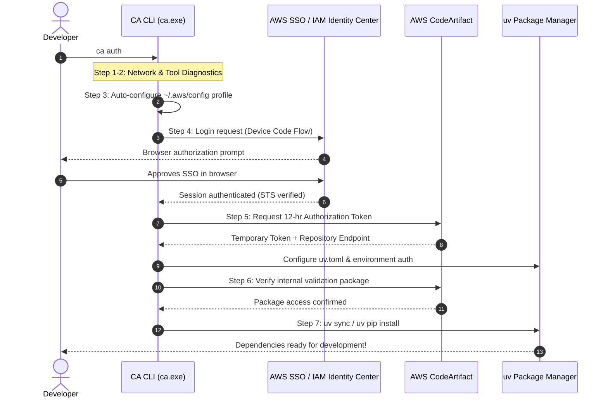

# CodeArtifact CLI (`CA CLI`)

[](https://go.dev/)
[](https://aws.amazon.com/sdk-for-go/)
[](https://github.com/astral-sh/uv)
[](#platform-support)
[](LICENSE)

> **The zero-friction, self-contained AWS CodeArtifact & SSO developer CLI for Python packages.**  
> Pre-configured by platform engineers, effortlessly executed by developers with a single command.

Repository: **[https://github.com/Sanvith6/CodeAritact-CLI.git](https://github.com/Sanvith6/CodeAritact-CLI.git)**

---

## 📌 Table of Contents

- [Why CA CLI? The Core Problem & Use Case](#-why-ca-cli-the-core-problem--use-case)
- [How It Works](#-how-it-works)
- [Security Model & Reverse Engineering Disclaimer](#-security-model--reverse-engineering-disclaimer)
- [Quickstart for Developers](#-quickstart-for-developers)
  - [Download Application](#1-download-the-executable)
  - [One-Command Bootstrap (`ca auth`)](#2-run-one-command-bootstrap)
  - [Installing Packages](#3-install-packages)
- [CLI Command Reference](#-cli-command-reference)
- [Platform & DevOps Workflow](#-platform--devops-workflow)
  - [1. Configure Organization Parameters](#1-configure-organization-parameters)
  - [2. Generate Embedded Code & Compile](#2-generate-embedded-code--compile)
  - [3. Distribute to Engineering](#3-distribute-to-engineering)
- [System Architecture](#-system-architecture)
- [Troubleshooting & Diagnostics](#-troubleshooting--diagnostics)
- [Contributing & Testing](#-contributing--testing)

---

## 🎯 Why CA CLI? The Core Problem & Use Case

### The Friction in Enterprise AWS CodeArtifact Onboarding

Organizations using private Python repositories on **AWS CodeArtifact** secured behind **AWS IAM Identity Center (SSO)** face significant friction when onboarding engineers:

1. **Information Overload**: Developers are forced to find and track internal AWS Account IDs, SSO Portal Start URLs, IAM Permission Set Roles, CodeArtifact Domain Owners, and Repository names.
2. **Ephemeral Credentials**: AWS CodeArtifact authorization tokens expire after a maximum of 12 hours. Developers frequently encounter cryptic `401 Unauthorized` or `403 Forbidden` errors mid-development.
3. **Complex Modern Tooling Configuration**: Configuring cutting-edge, ultra-fast Python package managers like Astral's [`uv`](https://docs.astral.sh/uv/) requires setting specific environment variables (`UV_INDEX_<NAME>_USERNAME` & `UV_INDEX_<NAME>_PASSWORD`) or editing global `uv.toml` files with basic-auth token strings.
4. **Brittle Legacy Scripts**: Engineering teams frequently maintain 600+ line shell or PowerShell scripts (e.g., `gitbashsup.sh`) that easily break on differing OS platforms, trigger Windows Firewall / UAC popups during local OAuth callback servers, or fail on non-standard terminal shells.

### The CA CLI Solution

**CA CLI (`ca.exe`)** condenses this entire multi-step setup into a **single, pre-compiled, self-contained executable**:

- **Zero Manual Configuration**: Developers do not need to edit `~/.aws/config`, construct PyPI URLs, or manage CodeArtifact tokens.
- **Embedded Organization Context**: The organization’s AWS SSO and CodeArtifact routing metadata is baked directly into the binary at build time by DevOps.
- **Firewall-Friendly Device Code Flow**: Authentication leverages `--use-device-code` to avoid local HTTP listener sockets that prompt Windows UAC/Firewall blocks.
- **Native uv Integration**: Seamlessly generates and updates `%APPDATA%\uv\uv.toml` (or `~/.config/uv/uv.toml` on Unix/macOS) with valid bearer tokens.
- **Resilient & Self-Healing**: Includes an automated rollback engine and an intelligent `doctor` diagnostic suite.

---

## ⚙️ How It Works



---

## 🛡️ Security Model & Reverse Engineering Disclaimer

CA CLI is architected around the principle of **simplifying developer experience without degrading cloud-native security**:

### 1. Abstracting Configuration vs. Security Boundaries
Embedding organization settings (AWS Account IDs, SSO Start URLs, CodeArtifact domain names) inside the binary eliminates configuration drift and cognitive load for engineers.

> [!IMPORTANT]
> **Reverse Engineering Disclaimer**:
> Client-side compiled binaries (including Go executables) are **not** encryption boundaries. Any determined individual with basic reverse-engineering tools (such as `strings`, Ghidra, IDA Pro, or decompilers) can inspect and extract the statically embedded strings and configuration values from `ca.exe`.

### 2. Why This is Safe by Design: Zero Hardcoded Secrets
- **No Private Keys or IAM Secrets**: The binary **never** contains long-lived AWS Access Keys, Secret Keys, or API tokens.
- **Identity Provider is the Gatekeeper**: The embedded values represent purely *infrastructure identifiers* (public metadata like an AWS Account ID and an SSO start URL).
- **Strict Cloud-Native Access Control**: Extraction of these parameters gives an attacker zero unauthorized access. Actual repository access **strictly requires a valid, authenticated enterprise SSO identity** with active corporate IdP credentials (e.g., Okta, Microsoft Entra ID, Ping Identity) and explicit AWS IAM role assignment.
- **Short-Lived Ephemeral Credentials**: All retrieved CodeArtifact tokens are temporary (max 12 hours) and scoped strictly to the authenticated developer's session.

---

## 🚀 Quickstart for Developers

### 1. Download the Executable

Clone the repository or download the pre-compiled binary:

```bash
git clone https://github.com/Sanvith6/CodeAritact-CLI.git
cd CodeAritact-CLI
```

The executable (`rs.exe` / `ca.exe`) is located in the root directory. You can add it to your `PATH` or invoke it directly from your terminal.

> [!TIP]
> You can rename or alias `rs.exe` to `ca.exe`:
> ```powershell
> Copy-Item .\rs.exe .\ca.exe
> ```

### 2. Run One-Command Bootstrap

Open your terminal in any Python project directory and run:

```powershell
.\ca.exe auth
```

The CLI executes the full onboarding pipeline:
1. `[1/7]` **Check network connectivity** (Internet and regional AWS endpoints).
2. `[2/7]` **Validate machine requirements** (`aws`, `git`, `uv`, `python`).
3. `[3/7]` **Check AWS SSO profile** (Configures `~/.aws/config` automatically).
4. `[4/7]` **Ensure AWS SSO login** (Opens default browser for authorization).
5. `[5/7]` **Configure uv package manager** (Fetches CodeArtifact token & injects into `uv.toml`).
6. `[6/7]` **Verify validation package** (Verifies private repository read access).
7. `[7/7]` **Sync project dependencies** (Executes `uv sync` or `uv pip install`).

### 3. Install Packages

Once bootstrapped, your environment is pre-authorized! Install private or public packages directly using standard `uv`:

```bash
# Add a dependency to pyproject.toml
uv add company-web==1.2.3

# Or install in an active virtualenv
uv pip install company-web
```

---

## 💻 CLI Command Reference

| Command | Aliases | Description |
| :--- | :--- | :--- |
| `ca auth` | `ca` | Runs the end-to-end guided developer onboarding workflow. |
| `ca doctor` | - | Runs diagnostics checking all tool dependencies and versions. |
| `ca doctor --fix` | - | Attempts automatic remediation and refreshes expired sessions. |
| `ca login` | - | Authenticates with AWS SSO and refreshes the CodeArtifact `uv` token. |
| `ca login --force` | `ca login -f` | Forces a fresh browser login flow even if current session is active. |
| `ca logout` | - | Logs out of active AWS SSO session. |
| `ca package` | - | Displays usage instructions and guidelines for `uv add`. |
| `ca version` | - | Displays CLI version, commit SHA, build number, and Go runtime. |

### Global Flags

- `-v, --verbose`: Enable debug-level structured logs (sensitive tokens are automatically redacted).
- `-q, --quiet`: Suppress all non-error console output.
- `--no-color`: Disable ANSI colored styling.
- `--non-interactive`: Disable interactive prompts and animations (ideal for CI/CD runners).
- `--json`: Output results in JSON format (available for `version` and diagnostics).

---

## 🛠️ Platform & DevOps Workflow

Platform and DevOps engineers can customize the embedded configuration for their specific enterprise organization.

### 1. Configure Organization Parameters

Edit [`configs/default.yaml`](file:///C:/project/rs-cli/configs/default.yaml):

```yaml
version: 1 

aws:
  sso:
    start_url: "https://your-company.awsapps.com/start"
    region: "us-east-1"
    account_id: "123456789012"
    role_name: "Developer-permission"
  profile_name: "Developer"
  region: "us-east-1"

artifact:
  domain: "my-company-factory"
  domain_owner: "123456789012"
  repository: "python-packages"
  region: "us-east-1"

package:
  uv_index_name: "internal"
  validation_package: "company-web"
  install_strategy: "add"

cli:
  log_level: "info"
  no_color: false
  non_interactive: false

features:
  codeartifact: true
  docker: false
  java: false
  terraform: false
  kubernetes: false
```

### 2. Generate Embedded Code & Compile

Compile the YAML configuration into Go code and build the final executable:

```powershell
# 1. Generate internal/config/embedded.go from configs/default.yaml
go generate ./...

# 2. Compile production executable
go build -ldflags="-s -w" -o ca.exe main.go
```

*(You can also use `make build` or `goreleaser` for cross-platform binaries)*

### 3. Distribute to Engineering

Distribute `ca.exe` as a single binary to your developers via:
- Internal developer portal or S3 download.
- Git repository releases: [https://github.com/Sanvith6/CodeAritact-CLI/releases](https://github.com/Sanvith6/CodeAritact-CLI.git).
- Internal OS package managers (`winget`, `homebrew`, `scoop`).

Developers do not need any additional config files—the binary is completely standalone.

---

## 🏗️ System Architecture

The internal codebase is built with modularity and extensibility:

```
rs-cli/
├── cmd/                          # Cobra CLI commands
│   ├── auth.go                   # login & logout commands
│   ├── bootstrap.go              # 'ca auth' 7-step onboarding workflow
│   ├── doctor.go                 # Environment diagnostics & --fix
│   ├── package.go                # Package helper guidance
│   ├── root.go                   # Root command & DI container setup
│   └── version.go                # Build & version details
├── configs/
│   └── default.yaml              # DevOps organization settings template
├── internal/
│   ├── buildinfo/                # Linker-injected metadata (version, commit)
│   ├── cache/                    # TTL file cache with SHA-256 hashed keys
│   ├── config/                   # Config schema, validator & embedded.go
│   ├── container/                # Dependency injection (DI) container
│   ├── errors/                   # User-friendly typed error codes
│   ├── features/                 # Dynamic feature toggles
│   ├── logging/                  # slog handler with auto-redacting of secrets
│   ├── network/                  # TCP/TLS HTTP health check endpoints
│   ├── platform/                 # Platform, OS, WSL, and path detection
│   │   ├── aws/                  # AWS SSO, STS, ProfileManager, & CodeArtifact
│   │   └── uv/                   # uv.toml generation and credentials injector
│   ├── retry/                    # Exponential backoff with jitter
│   ├── runner/                   # Safe tokenized subprocess execution
│   ├── services/                 # AuthService, RepositoryService, EnvService
│   ├── state/                    # Atomic state management (~/.rs/state.json)
│   ├── ui/                       # Lipgloss styling, spinners, & tables
│   ├── validator/                # System tools requirement verifier
│   └── workflow/                 # Sequential step execution & rollback engine
├── scripts/
│   └── generate_config.go        # Code-generator: YAML -> Go struct
└── main.go                       # Application entrypoint
```

---

## 🩺 Troubleshooting & Diagnostics

If an engineer encounters issues, run:

```powershell
.\ca.exe doctor
```

Sample output:

```text
========================================
    Environment Diagnostics (ca doctor)
========================================
Checking system requirements and configuration...

┌────────┬──────────────┬────────────────────────┐
│ STATUS │ TOOL         │ VERSION                │
├────────┼──────────────┼────────────────────────┤
│ ✓      │ AWS CLI v2   │ 2.15.30                │
│ ✓      │ uv           │ 0.1.25                 │
│ ✓      │ Git          │ 2.42.0                 │
│ ✓      │ Python       │ 3.11.8                 │
└────────┴──────────────┴────────────────────────┘

✓ All checks passed. Your environment is ready.
```

If checks fail or credentials have expired:
```powershell
.\ca.exe doctor --fix
```

---

## 🧪 Contributing & Testing

Run the full automated test suite:

```bash
go test -v -race ./...
```

Run linter:

```bash
golangci-lint run
```

---

## 📄 License

Licensed under the [Apache License, Version 2.0](LICENSE).
Distributed as part of the Enterprise Platform Tooling initiative.
