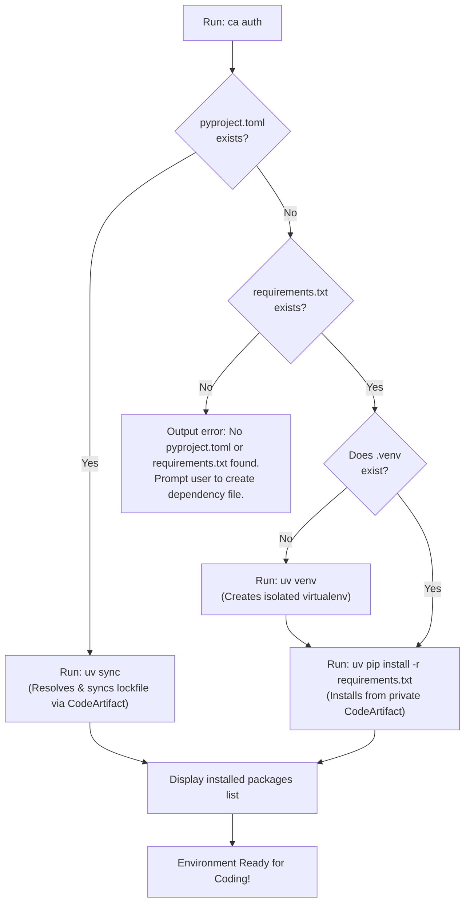

# CodeArtifact CLI (`CA CLI`)

[](https://go.dev/)
[](https://aws.amazon.com/sdk-for-go/)
[](https://github.com/astral-sh/uv)
[](#platform-support)
[](LICENSE)

> **The Zero-Knowledge, Self-Contained AWS CodeArtifact & SSO Developer CLI for Python Packages.**  
> Built for open-source and enterprise teams: Developers never need to know internal AWS Account IDs, Regions, SSO URLs, or CodeArtifact endpoints.

GitHub Repository: **[https://github.com/Sanvith6/CodeAritact-CLI.git](https://github.com/Sanvith6/CodeAritact-CLI.git)**

---

## 📌 Table of Contents

- [The Core Philosophy: Zero-Knowledge Developer Experience](#-the-core-philosophy-zero-knowledge-developer-experience)
- [How to Get `ca.exe`](#-how-to-get-caexe)
  - [Option 1: One-Line PowerShell Download (Fastest)](#option-1-one-line-powershell-download-fastest)
  - [Option 2: Direct GitHub Download](#option-2-direct-github-download)
  - [Option 3: Build from Source](#option-3-build-from-source)
- [Developer Guide: How to Use CA CLI](#-developer-guide-how-to-use-ca-cli)
  - [Step 1: Place `ca.exe` in your Project](#step-1-place-caexe-in-your-project)
  - [Step 2: Run `ca auth` (Automatic Dependency Installation)](#step-2-run-ca-auth-automatic-dependency-installation)
  - [Step 3: Managing Packages (`requirements.txt` vs `pyproject.toml`)](#step-3-managing-packages-requirementstxt-vs-pyprojecttoml)
- [How Dependency Syncing Works](#-how-dependency-syncing-works)
- [DevOps & Maintainer Guide: Configuring `scripts/` & Generating the Binary](#-devops--maintainer-guide-configuring-scripts--generating-the-binary)
  - [1. Configure `configs/default.yaml`](#1-configure-configsdefaultyaml)
  - [2. How `scripts/generate_config.go` Embeds the Infrastructure](#2-how-scriptsgenerate_configgo-embeds-the-infrastructure)
  - [3. Run the Generator & Compile](#3-run-the-generator--compile)
  - [4. Distribute the Standalone `ca.exe`](#4-distribute-the-standalone-caexe)
- [CLI Command Reference](#-cli-command-reference)
- [Security Model & Reverse Engineering Disclaimer](#-security-model--reverse-engineering-disclaimer)
- [System Architecture & Lifecycle](#-system-architecture--lifecycle)
- [Troubleshooting with `ca doctor`](#-troubleshooting-with-ca-doctor)
- [Contributing & Testing](#-contributing--testing)
- [License](#-license)

---

## 💡 The Core Philosophy: Zero-Knowledge Developer Experience

### The Traditional Problem
Setting up private Python packages hosted on **AWS CodeArtifact** secured by **AWS IAM Identity Center (SSO)** is notoriously frustrating:
- Developers must manually discover and configure:
  - AWS Account ID (e.g. `080800845757`)
  - AWS SSO Portal Start URL (e.g. `https://d-xxxxxx.awsapps.com/start`)
  - AWS SSO Region (e.g. `us-east-1`)
  - IAM Role / Permission Set (e.g. `Developer-permission`)
  - CodeArtifact Domain Name, Owner Account ID, and Repository Name
- CodeArtifact tokens expire every 12 hours, causing mysterious build breakages.
- Developers are forced to deal with complex package manager configurations for tools like Astral's [`uv`](https://github.com/astral-sh/uv).
- Teams resort to brittle, multi-hundred line shell scripts (like `gitbashsup.sh`) that trigger Windows Firewall prompts, fail across different operating systems, and leak infrastructure details into local terminal histories.

### The CA CLI Solution
**CA CLI (`ca.exe`) abstracts 100% of internal AWS details away from developers**:
- **Zero Region or Account ID Knowledge**: Developers never touch or see Account IDs, SSO URLs, or repository ARNs.
- **Single Command Setup**: Developers drop `ca.exe` into their repository and run `.\ca.exe auth`.
- **Automatic Environment Preparation**: It verifies system tools, authenticates via browser SSO, fetches the temporary CodeArtifact token, writes `uv.toml`, creates a virtual environment, and installs dependencies from `requirements.txt` or `pyproject.toml` automatically.

---

## 📥 How to Get `ca.exe`

Choose the method that works best for your workflow:

### Option 1: One-Line PowerShell Download (Fastest)

Run this command in your project directory (PowerShell):

```powershell
Invoke-WebRequest -Uri "https://github.com/Sanvith6/CodeAritact-CLI/raw/main/ca.zip" -OutFile "ca.zip"; Expand-Archive ca.zip -DestinationPath . -Force; Remove-Item ca.zip
```

This instantly downloads `ca.zip`, extracts `ca.exe` into your current directory, and cleans up the zip archive.

---

### Option 2: Direct GitHub Download

1. Navigate to the repository: **[https://github.com/Sanvith6/CodeAritact-CLI](https://github.com/Sanvith6/CodeAritact-CLI)**
2. Download **[`ca.zip`](https://github.com/Sanvith6/CodeAritact-CLI/raw/main/ca.zip)** (or [`rs.zip`](https://github.com/Sanvith6/CodeAritact-CLI/raw/main/rs.zip)).
3. Extract `ca.exe` and place it in your project root or add it to your system `PATH`.

---

### Option 3: Build from Source

If you have Go 1.22+ installed:

```bash
git clone https://github.com/Sanvith6/CodeAritact-CLI.git
cd CodeAritact-CLI
go generate ./...
go build -o ca.exe main.go
```

---

## 👩‍💻 Developer Guide: How to Use CA CLI

### Step 1: Place `ca.exe` in your Project

Ensure your project contains either a `requirements.txt` or a `pyproject.toml`:

```text
my-python-project/
├── ca.exe                 <-- Downloaded CLI
├── requirements.txt       <-- (or pyproject.toml)
└── main.py
```

---

### Step 2: Run `ca auth` (Automatic Dependency Installation)

In your terminal (PowerShell, Command Prompt, Git Bash, or Terminal), run:

```powershell
.\ca.exe auth
```

The CLI executes the guided 7-step bootstrap:

```text
 █▀█ █▀
 █▀▄ ▄█  Platform CLI
   v1.0.0

Bootstrapping Developer Environment
This process will ensure your machine is ready for development.

[1/7] ✓ Check network connectivity
[2/7] ✓ Validate machine requirements
[3/7] ✓ Check AWS SSO profile
[4/7] ✓ Ensure AWS SSO login
[5/7] ✓ Configure uv package manager
[6/7] ✓ Verify validation package
[7/7] ✓ Sync project dependencies

══════════════════════════════════════
        RS Platform CLI
══════════════════════════════════════
✓ AWS SSO Login
✓ AWS Identity Verified
✓ CodeArtifact Connected
✓ uv Configured
✓ Repository Verified
✓ Dependencies Synced
══════════════════════════════════════
Developer environment is ready.

Installed Packages:
company-web==1.2.3
requests==2.31.0
pydantic==2.6.4
...
```

---

### Step 3: Managing Packages (`requirements.txt` vs `pyproject.toml`)

Once authenticated, your environment is connected to both private CodeArtifact and public PyPI!

#### Working with `requirements.txt`:
1. Add any internal or public package to `requirements.txt`:
   ```text
   company-web==1.2.3
   requests>=2.31.0
   ```
2. Re-run `.\ca.exe auth` to sync dependencies, or install directly using `uv`:
   ```powershell
   uv pip install -r requirements.txt
   ```

#### Working with `pyproject.toml`:
1. Install new packages directly:
   ```powershell
   uv add company-web==1.2.3
   ```
2. Or sync existing lockfiles:
   ```powershell
   uv sync
   ```

---

## 🔄 How Dependency Syncing Works

CA CLI's sync step intelligently detects how your Python project is structured:



---

## 🛠️ DevOps & Maintainer Guide: Configuring `scripts/` & Generating the Binary

As a Platform Engineer or Open-Source Maintainer, you create the pre-configured `ca.exe` for your engineering team. Developers never need to modify configuration files.

### 1. Configure `configs/default.yaml`

Edit [`configs/default.yaml`](file:///C:/project/rs-cli/configs/default.yaml) with your cloud environment parameters:

```yaml
version: 1 

aws:
  sso:
    start_url: "https://d-906679b0a1.awsapps.com/start"  # Your SSO Portal URL
    region: "us-east-1"                                  # SSO Region
    account_id: "080800845757"                           # Target AWS Account ID
    role_name: "Developer-permission"                    # IAM Role / Permission Set
  profile_name: "Developer"                              # Local AWS Profile Name
  region: "us-east-1"

artifact:
  domain: "grag-ai-factory"                              # CodeArtifact Domain
  domain_owner: "080800845757"                           # Domain Owner Account ID
  repository: "python-packages"                          # CodeArtifact Repository
  region: "us-east-1"

package:
  uv_index_name: "internal"                              # Name of the uv index
  validation_package: "company-web"                      # Internal canary package to verify access
  install_strategy: "add"

cli:
  log_level: "info"
  no_color: false
  non_interactive: false

features:
  codeartifact: true
  docker: false
  java: false
  terraform: false
  kubernetes: false
```

---

### 2. How `scripts/generate_config.go` Embeds the Infrastructure

To prevent developers from needing a local YAML file, [`scripts/generate_config.go`](file:///C:/project/rs-cli/scripts/generate_config.go) compiles `configs/default.yaml` into statically baked Go code:

1. It reads `configs/default.yaml`.
2. It parses the YAML into typed configurations.
3. It writes a production Go file directly to [`internal/config/embedded.go`](file:///C:/project/rs-cli/internal/config/embedded.go):
   ```go
   // Code generated by scripts/generate_config.go. DO NOT EDIT.
   package config

   var DefaultConfig = &Config{
       Version: 1,
       AWS: AWSConfig{
           SSO: SSOConfig{
               StartURL:  "https://d-906679b0a1.awsapps.com/start",
               Region:    "us-east-1",
               AccountID: "080800845757",
               RoleName:  "Developer-permission",
           },
           ...
       },
   }
   ```

---

### 3. Run the Generator & Compile

In repository root, run:

```powershell
# Step 1: Run the generator script to bake YAML into Go
go generate ./...

# (Alternatively, you can run the script directly:)
# go run scripts/generate_config.go

# Step 2: Compile the final optimized single executable
go build -ldflags="-s -w" -o ca.exe main.go

# Step 3: (Optional) Package into zip for easy developer distribution
Compress-Archive -Path ca.exe -DestinationPath ca.zip -Force
```

---

### 4. Distribute the Standalone `ca.exe`

Once built:
- Commit and push `ca.zip` or attach `ca.exe` to [GitHub Releases](https://github.com/Sanvith6/CodeAritact-CLI/releases).
- Developers download `ca.exe` and immediately run `.\ca.exe auth`.
- **No environment variables, no manual AWS CLI configuration, and no account IDs required.**

---

## 💻 CLI Command Reference

| Command | Flags | Description |
| :--- | :--- | :--- |
| `ca auth` | - | **Main command.** Runs full guided 7-step onboarding and dependency sync. |
| `ca doctor` | `--fix` | Diagnostic check of tool prerequisites (`aws`, `git`, `uv`, `python`). Use `--fix` to auto-remediate. |
| `ca login` | `-f, --force` | Manual login to AWS SSO; refreshes CodeArtifact token and updates `uv.toml`. |
| `ca logout` | - | Revokes and clears the active AWS SSO session. |
| `ca package` | - | Displays usage instructions for adding packages using `uv add`. |
| `ca version` | `--json` | Prints CLI version, commit SHA, build date, architecture, and organization. |

---

## 🛡️ Security Model & Reverse Engineering Disclaimer

### 1. Abstracting Configuration vs. Encryption Boundaries
The purpose of embedding configuration into `ca.exe` is **ergonomics and governance**: it removes manual configuration, prevents typos, and standardizes identity routines across engineering.

> [!IMPORTANT]
> **Reverse Engineering Disclaimer**:
> Client-side compiled binaries (including Go executables) are **not** cryptographic vaults. Any determined actor or security engineer can inspect or reverse engineer the binary (e.g., using `strings`, Ghidra, IDA Pro, or decompilers) to extract the embedded configuration strings (such as Account IDs, Domain Names, or SSO URLs).

### 2. Why This is Safe by Design: Zero Hardcoded Secrets
- **No IAM Credentials Inside**: The binary **never** embeds AWS Access Keys, Secret Keys, or permanent tokens.
- **Identity Provider is the Gatekeeper**: The embedded values represent purely *infrastructure routing metadata*. Knowing an Account ID or SSO URL provides zero access without an active, authenticated enterprise SSO account (e.g. Okta, Azure AD, Ping) assigned to the designated IAM Role.
- **Short-Lived Ephemeral Tokens**: All CodeArtifact authorization tokens obtained during `ca auth` or `ca login` are temporary (12 hours maximum) and tied strictly to the authenticated developer's session.
- **Token Redaction in Logs**: The internal logging subsystem ([`redactor.go`](file:///C:/project/rs-cli/internal/logging/redactor.go)) automatically sanitizes any log attributes matching `token`, `secret`, `password`, `credential`, or `authorization`.

---

## 🏗️ System Architecture & Lifecycle

```text
rs-cli/
├── cmd/                          # Cobra CLI commands (auth, doctor, login, package)
├── configs/
│   └── default.yaml              # Master DevOps organization settings template
├── internal/
│   ├── buildinfo/                # Build metadata (version, commit hash)
│   ├── cache/                    # Disk cache with SHA-256 hashed keys
│   ├── config/                   # Config schema, loader, and embedded.go
│   ├── container/                # Central Dependency Injection (DI) container
│   ├── errors/                   # User-facing structured error codes
│   ├── features/                 # Dynamic feature flag toggles
│   ├── logging/                  # slog handler with automated token redactor
│   ├── network/                  # TCP/TLS HTTP health checks (Internet & AWS STS)
│   ├── platform/                 # Cross-platform path detection (~/.aws, uv.toml)
│   │   ├── aws/                  # AWS SSO, STS, ProfileManager, & CodeArtifact SDK
│   │   └── uv/                   # uv.toml generation and credentials injector
│   ├── runner/                   # Safe tokenized subprocess runner (no shell injection)
│   ├── services/                 # AuthService, RepositoryService, EnvironmentService
│   ├── state/                    # Thread-safe atomic state manager (~/.rs/state.json)
│   ├── ui/                       # Terminal styling, banners, tables, and spinners
│   ├── validator/                # Minimum tool version checks
│   └── workflow/                 # Step-based workflow engine with automatic rollback
├── scripts/
│   └── generate_config.go        # Code Generator: YAML -> Go source
└── main.go                       # Application entrypoint (//go:generate directive)
```

---

## 🩺 Troubleshooting with `ca doctor`

If you run into issues or install a new tool, run `ca doctor`:

```powershell
.\ca.exe doctor
```

```text
========================================
    Environment Diagnostics (ca doctor)
========================================
Checking system requirements and configuration...

┌────────┬──────────────┬────────────────────────┐
│ STATUS │ TOOL         │ VERSION                │
├────────┼──────────────┼────────────────────────┤
│ ✓      │ AWS CLI v2   │ 2.15.30                │
│ ✓      │ uv           │ 0.1.25                 │
│ ✓      │ Git          │ 2.42.0                 │
│ ✓      │ Python       │ 3.11.8                 │
└────────┴──────────────┴────────────────────────┘

✓ All checks passed. Your environment is ready.
```

To automatically refresh expired credentials and reconfigure `uv`:
```powershell
.\ca.exe doctor --fix
```

---

## 🧪 Contributing & Testing

Run all unit tests across the repository:

```bash
go test -v -race ./...
```

Run code vet and linter:

```bash
go vet ./...
golangci-lint run
```

---

## 📄 License

Licensed under the [MIT License](LICENSE).  
Open-source contribution for simplified enterprise cloud developer onboarding.
